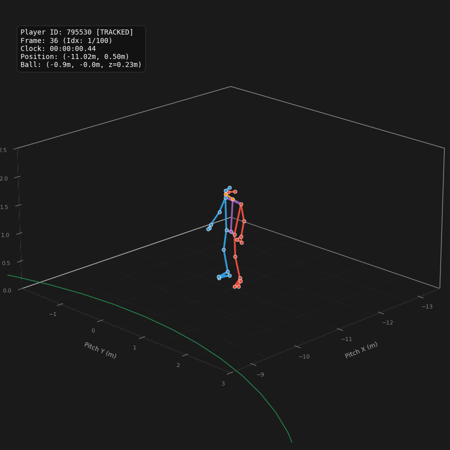
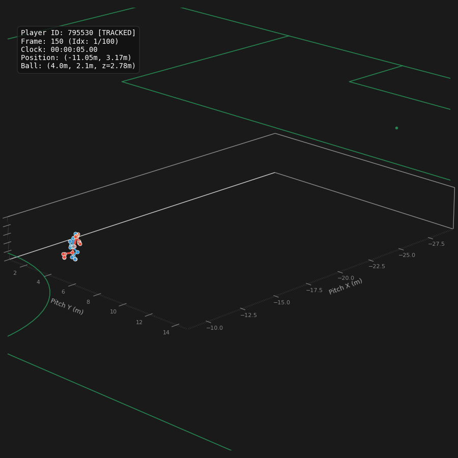
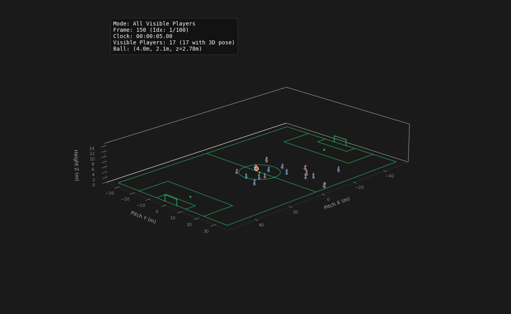
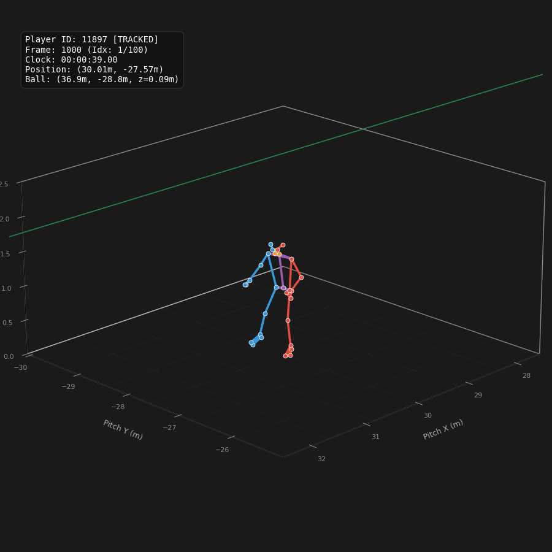

# SkillCorner Open Data Body Pose Visualizer

3D visualizer tool for [SkilCorner's Body Pose dataset](https://github.com/SkillCorner/opendata/tree/master/data/bodypose)

## 3D Body Pose Animation (`animate.py`)

A Python animation script is provided in this repository to visualize 3D body pose tracking data for soccer players. Inspired by the [Sport Performance Lab (SPL) basketball animation tool](https://github.com/Sport-Performance-Lab/SPL-Open-Data/blob/main/basketball/freethrow/animate.py).

### Features
- **29 Anatomical Joints & 41 Connections:** Complete skeleton graph covering head/craniofacial, spine, torso/pelvis, arms/hands, and legs/feet.
- **Side & Limb Color Coding:** Distinguishes left limbs (coral red), right limbs (dodger blue), central spine/torso (purple), and head (amber) for enhanced depth perception in 3D.
- **3D Pitch & Ground Plane:** Renders field markings (touchlines, penalty boxes, center circle, 3D goalposts) and localized ground depth cues at ground level ($z=0$).
- **Integrated Ball Tracking:** Plots the 3D ball trajectory when detected.
- **Memory-Safe Streaming:** Streams `.jsonl` line-by-line with fast seeking, handling multi-gigabyte match files in seconds without loading the full file into RAM.
- **Local File Export:** Saves animations directly to `.mp4` (via `ffmpeg`) or `.gif` (via `pillow`) with real-time progress reporting.

### Command-Line Usage

```bash
# Animate 100 frames for player 795530 starting at frame 36 and save to MP4
python animate.py --match-id 1925299 -s 36 -n 100 -p 795530 -o player_795530.mp4
```



```bash
# Animate single player with camera fixed to their movement region (no camera pan)
python animate.py -m 1925299 -s 150 -n 100 -p 795530 --fixed-view -o player_fixed_view.gif
```



```bash
# Animate all visible players without joint markers across the whole pitch for 100 frames
python animate.py -m 1925299 -a -s 150 -n 100 --no-joints -o all_players_pitch.mp4
```



```bash
# Auto-detect the most active player in a frame window
python animate.py -m 1925299 -s 1000 -n 100 -o most_active_player.mp4
```



```bash
# Discover active players and pose coverage in a frame window
python animate.py -m 1925299 -s 36 -n 250 --list-players
[*] Input file: raw/1925299.jsonl
[*] Scanning 250 frames starting at frame 36 for active players...
Player ID    | Team ID    | Valid Pose Frames  | Coverage (%)
-------------------------------------------------------------
50982        | 871        | 250                |  100.0%
795530       | 871        | 250                |  100.0%
51694        | 871        | 250                |  100.0%
560987       | 871        | 250                |  100.0%
966114       | 871        | 250                |  100.0%
560984       | 871        | 250                |  100.0%
51043        | 1802       | 250                |  100.0%
51002        | 1802       | 250                |  100.0%
560882       | 1802       | 250                |  100.0%
797298       | 1802       | 250                |  100.0%
560986       | 1802       | 250                |  100.0%
795537       | 1802       | 250                |  100.0%
560989       | 871        | 233                |   93.2%
809166       | 871        | 208                |   83.2%
11897        | 871        | 198                |   79.2%
287934       | 1802       | 193                |   77.2%
560983       | 1802       | 178                |   71.2%
965697       | 1802       | 156                |   62.4%
51050        | 1802       | 153                |   61.2%
966112       | 871        | 113                |   45.2%
560985       | 871        | 0                  |    0.0%
50999        | 1802       | 0                  |    0.0%
69111        | 1802       | 0                  |    0.0%
560988       | 871        | 0                  |    0.0%
966115       | 871        | 0                  |    0.0%
795533       | 871        | 0                  |    0.0%
795541       | 1802       | 0                  |    0.0%
51722        | 1802       | 0                  |    0.0%
965698       | 1802       | 0                  |    0.0%
809869       | 871        | 0                  |    0.0%
333110       | 1802       | 0                  |    0.0%
966113       | 871        | 0                  |    0.0%
```

### CLI Flags

| Flag | Argument | Description |
|---|---|---|
| `-a`, `--all-players` | *flag* | Animate all visible players on the pitch (defaults to fixed whole pitch view). |
| `--whole-pitch`, `--fixed-pitch` | *flag* | Fix camera view to show the entire soccer pitch. (Default when `--all-players` is set). |
| `--no-whole-pitch` | *flag* | Disable whole pitch camera view and dynamically follow player/centroid. |
| `-s`, `--start-frame` | `int` | Starting frame number (0-indexed). Auto-detected if omitted. |
| `-n`, `--num-frames` | `int` | Number of frames to animate (default: `100`, ~4 sec at 25 fps). |
| `-p`, `--player-id` | `int` | Target player ID (single-player mode). Auto-selects active player if omitted. |
| `-o`, `--output` | `str` | Output path (`.mp4` or `.gif`). Defaults to `pose_<player_id\|all_players>_f<start>_<n>frames.mp4`. |
| `--list-players` | *flag* | Scans the frame window, prints active player IDs and coverage, and exits. |
| `--elev`, `--azim` | `float` | 3D camera elevation and azimuth angles (defaults: `20.0`, `45.0`). |
| `--xbuffer`, `--ybuffer` | `float` | View half-buffers in metres around player hip (default: `2.5`). |
| `--zlim` | `float` | Height limit for z-axis in metres (default: `2.5` in follow mode, `15.0` in whole-pitch mode). |
| `--player-color` | `str` | Uniform skeleton color when not coloring by side (default: `royalblue`). |
| `--no-color-by-side` | *flag* | Disable side coloring (use uniform `--player-color`). |
| `--no-ball` | *flag* | Do not render the ball trajectory. |
| `--no-pitch` | *flag* | Do not render field markings at $z=0$. |
| `--no-joints` | *flag* | Render lines only (no joint marker points). |
| `--no-axis` | *flag* | Turn off the 3D coordinate pane axis and tick marks. |
| `--fixed-view` | *flag* | Fix camera to player movement region instead of tracking/following player. |
| `--max-error-cm` | `float` | Filter out joints where `p90_mae_cm` exceeds threshold. |

### Python API Usage

You can also import and use the function in custom scripts or Jupyter notebooks:

```python
from animate import animate_soccer_pose, CONNECTIONS

# Animate all visible players across the full pitch
anim_all = animate_soccer_pose(
    path_to_jsonl="raw/1925299.jsonl",
    start_frame=36,
    num_frames=100,
    all_players=True,
    output_path="all_players.mp4",
)

# Animate a single player in tracking follow mode
anim_single = animate_soccer_pose(
    path_to_jsonl="raw/1925299.jsonl",
    start_frame=36,
    num_frames=100,
    player_id=795530,
    output_path="player_795530.mp4",
)
```

## Related data

The rest of the open dataset — broadcast tracking, dynamic events, phases of
play and season aggregates for 20 A-League matches — lives at
[github.com/SkillCorner/opendata](https://github.com/SkillCorner/opendata),
along with tutorials.

## Licence and credit

MIT, matching the opendata repository.

If you use this data we kindly ask that you credit SkillCorner, and we would
love to hear what you build — tell us on [X/Twitter](https://twitter.com/skillcorner).
